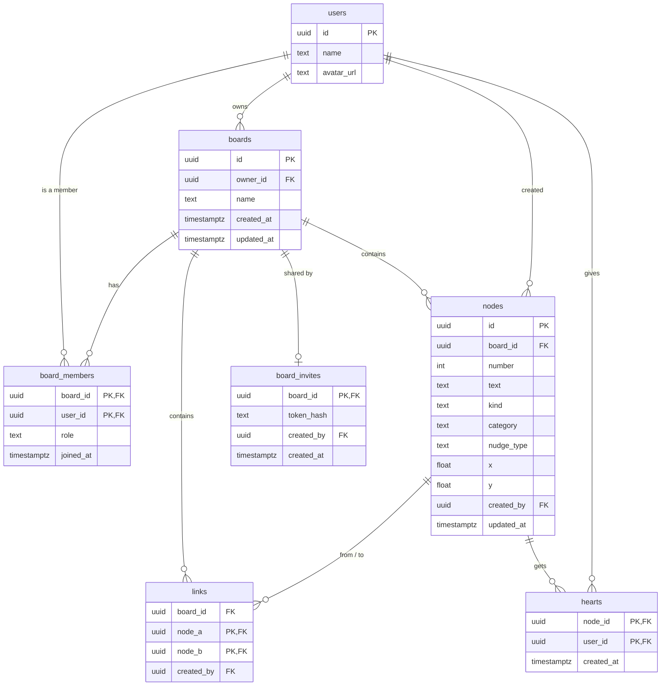

# Database design

The plan for accounts and shared boards, on [Supabase](https://supabase.com) (Postgres, its sign-in, and live updates). Nothing here is built yet: today boards live in the browser (see [architecture](mvp/architecture.md)). This is what the code will be changed towards.

## Decisions

| | |
|---|---|
| Accounts | Optional. Everything works without one, with boards saved in the browser as today. Signing in is always there (a "sign in" button in the nav bar) and is asked for when you share a board. With an account, your boards are on every device you sign in on, and backed up. |
| Sign-in | GitHub or Google, through Supabase Auth. No passwords are stored by Floppy Thoughts at all. |
| Sharing | By invite link. Anyone signed in who opens the link joins the board. The owner can turn the link off or make a new one. |
| Hearts | Each person hearts what they like; everyone on the board sees who hearted what. The box with the most hearts is the board's top pick. There is no separate "chosen idea". |
| How we got there | The trail from the notes to an idea can be opened from any hearted box. |
| Signing in later | The boards in your browser are uploaded to your account the first time you sign in, so nothing made before is lost. |
| Projects (later) | Link an idea to the repo you built. GitHub asks for permission to read repos only then, not at sign-in. |

## Entities and relationships

`users` is Supabase Auth's own table (`auth.users`), with a small `profiles` table beside it for the name and picture shown on hearts.

## Tables

### boards
| Column | Type | Notes |
|---|---|---|
| `id` | `uuid` | Primary key, random |
| `owner_id` | `uuid` | → `auth.users`. The person who made it |
| `name` | `text` | 1–80 characters |
| `created_at`, `updated_at` | `timestamptz` | `updated_at` changes whenever anything on the board does (for "most recent" sorting) |

### board_members
Who can open a board, and what they can do. The owner is a member too.

| Column | Type | Notes |
|---|---|---|
| `board_id` | `uuid` | → `boards`, deleted with the board |
| `user_id` | `uuid` | → `auth.users` |
| `role` | `text` | `owner`, `editor` or `viewer` |
| `joined_at` | `timestamptz` | |

Primary key `(board_id, user_id)`: someone can only be on a board once.

### nodes
The boxes: themes, notes from the machine, your ideas, nudges.

| Column | Type | Notes |
|---|---|---|
| `id` | `uuid` | Primary key, random. Made on the device, so two people adding at once never clash |
| `board_id` | `uuid` | → `boards`, deleted with the board |
| `number` | `int` | The short number shown on the box and used in commands (`/link 3 7`). Unique per board |
| `text` | `text` | 1–200 characters |
| `kind` | `text` | `spark` (a theme or a note), `user` (your idea) or `nudge` |
| `category` | `text` | For sparks: `theme`, `words`, `objects`, `problems`, `curiosities`, `nature`, `constraints` |
| `nudge_type` | `text` | For nudges: `related`, `opposite`, `described`, `perspective`, `scale`, `senses`, `wildcard`, `push` |
| `x`, `y` | `float` | Where it sits on the board |
| `created_by` | `uuid` | → `auth.users`, so others can see who added it |
| `updated_at` | `timestamptz` | For merging changes from two people (the later edit wins, box by box) |

Checks: `category` only on sparks, `nudge_type` only on nudges. Themes are locked (only editable, never replaced by the machine), as today.

### links
Links have no direction, so each pair is stored once, with the smaller id first.

| Column | Type | Notes |
|---|---|---|
| `board_id` | `uuid` | → `boards` |
| `node_a`, `node_b` | `uuid` | → `nodes`, deleted with either box. `node_a < node_b` |
| `created_by` | `uuid` | → `auth.users` |

Primary key `(node_a, node_b)`; both boxes must be on `board_id`.

### hearts
| Column | Type | Notes |
|---|---|---|
| `node_id` | `uuid` | → `nodes`, deleted with the box |
| `user_id` | `uuid` | → `auth.users` |
| `created_at` | `timestamptz` | |

Primary key `(node_id, user_id)`: one heart per person per box. The board's top pick is the box with the most rows here (ties: the earliest to reach that count).

### board_invites
One live invite link per board.

| Column | Type | Notes |
|---|---|---|
| `board_id` | `uuid` | Primary key, → `boards` |
| `token_hash` | `text` | A hash of the secret in the link, never the secret itself. If the database were ever read by someone else, the links still couldn't be used |
| `created_by` | `uuid` | → `auth.users` |
| `created_at` | `timestamptz` | |

Turning the link off deletes the row; making a new one replaces it, so old links stop working.

## Indexes

Beyond the primary keys:

- `nodes (board_id)`, `links (board_id)`: loading a board.
- `nodes (board_id, number)`, unique: finding a box by its number, and keeping numbers unique.
- `board_members (user_id)`: "my boards".
- `hearts (node_id)`: counting hearts on a board's boxes.

Boards are small (at most 1,000 boxes), so these are enough.

## Who can do what (row-level security)

Every table has row-level security on, so the database itself refuses anything not allowed, whatever the app sends.

| | Viewer | Editor | Owner |
|---|---|---|---|
| See the board, its boxes, links and hearts | ✓ | ✓ | ✓ |
| Heart and unheart (their own hearts only) | ✓ | ✓ | ✓ |
| Add, edit, move, link and delete boxes | | ✓ | ✓ |
| Rename the board | | ✓ | ✓ |
| Make or turn off the invite link, change roles, remove people | | | ✓ |
| Delete the board | | | ✓ |

Someone who isn't a member can't see a board exists. Joining through an invite runs in one database function that checks the link's hash and adds the member as an `editor`, so the token is never readable from the app.

Each policy gets a test: as an owner, an editor, a viewer, a stranger and someone signed out.

## On the device

The app keeps working the way it feels now: changes show at once and are saved in the background.

- Signed out, boards are saved only in the browser, exactly as today (no database involved).
- Signed in, the open board is still kept in the browser (local-first), and the database holds the shared copy. Each change is saved as the boxes and links it touches, not the whole board.
- Other people's changes arrive through Supabase's live updates and are merged in, box by box.
- Offline, changes queue up and are sent when the connection is back.
- Undo and redo stay on your device and only undo your own changes.

No server-side cache is needed at this size. The app's files are cached by the host. Word lookups for nudges will be cached by the small proxy in front of Datamuse.

## Signing in for the first time

Boards saved in the browser use box ids `n1, n2, …`. On first sign-in each one is uploaded with new random ids, keeping the short numbers and the links, and you become its owner. Favourites become your hearts. The browser copy is kept until the upload is confirmed.

From then on, signed in, new boards go to your account. Signing out removes your account's boards from that browser (so a shared computer doesn't keep them), and the app goes back to browser-only boards.
