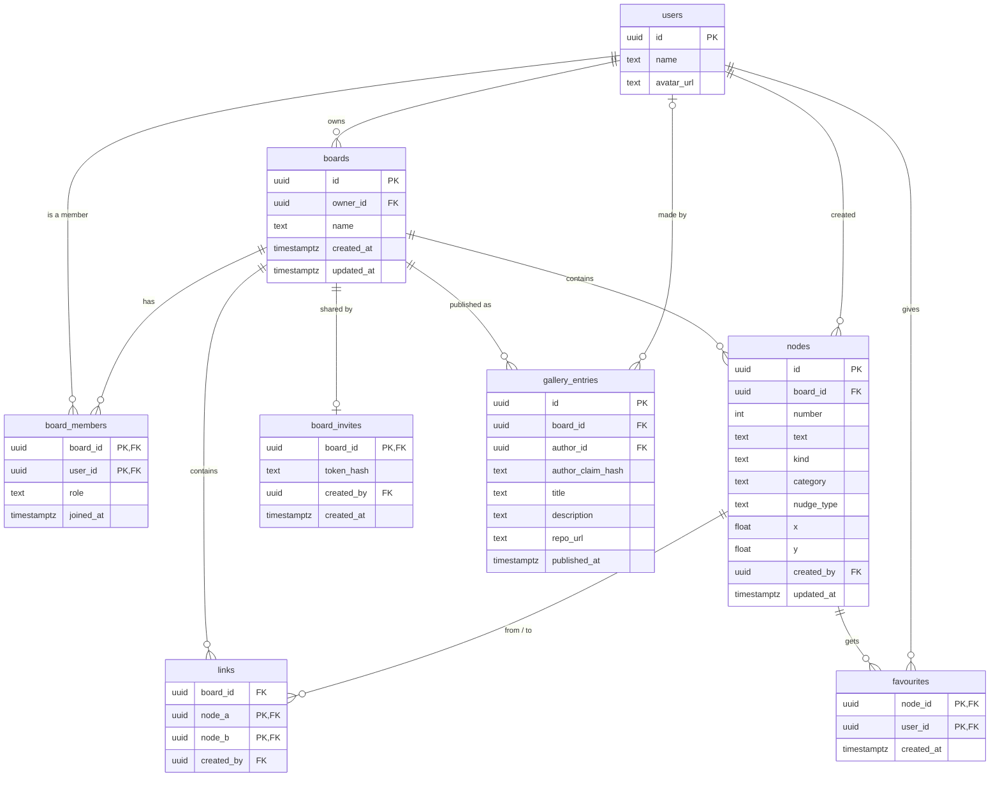

# Database design

The plan for accounts and shared boards, on [Supabase](https://supabase.com) (Postgres, its sign-in, and live updates). Nothing here is built yet: today boards live in the browser (see [architecture](mvp/architecture.md)). This is what the code will be changed towards.

## Decisions

| | |
|---|---|
| Accounts | Optional. Everything works without one, with boards saved in the browser as today. Signing in is always there (a "sign in" button in the nav bar) and is asked for when you share a board. With an account, your boards are on every device you sign in on, and backed up. |
| Sign-in | GitHub or Google, through Supabase Auth. No passwords are stored by Floppy Thoughts at all. |
| Sharing | By invite link. Anyone signed in who opens the link joins the board. The owner can turn the link off or make a new one. |
| Favourites | Each person favourites what they like (shown as a heart); everyone on the board sees who favourited what, and how many. The summary lists the favourite ideas, most favourited first. There is no separate "chosen idea". |
| How we got there | The trail from the notes to an idea can be opened from any favourite idea. |
| Signing in later | The boards in your browser are uploaded to your account the first time you sign in, so nothing made before is lost. |
| Collaboration | The heart of the tool: a board can be worked on by a team at the same time. You see who's on the board right now, their changes appear live, every box shows who added it, and favourites show who liked what. |
| Projects and the gallery (later) | Link an idea to the repo you built, and publish it to a community gallery. GitHub asks for permission to read repos only then, not at sign-in. |
| Age | Accounts are for 13 and over. |

## Entities and relationships

`users` is Supabase Auth's own table (`auth.users`), with a small `profiles` table beside it for the name and picture shown on favourites.

## Tables

### boards
| Column | Type | Notes |
|---|---|---|
| `id` | `uuid` | Primary key, random |
| `owner_id` | `uuid` | → `auth.users`. The person who made it |
| `name` | `text` | 1–80 characters |
| `created_at`, `updated_at` | `timestamptz` | `updated_at` changes whenever anything on the board does (for "most recent" sorting) |

### board_members
Who can open a board, and what they can do. The owner is a member too.

| Column | Type | Notes |
|---|---|---|
| `board_id` | `uuid` | → `boards`, deleted with the board |
| `user_id` | `uuid` | → `auth.users` |
| `role` | `text` | `owner`, `editor` or `viewer` |
| `joined_at` | `timestamptz` | |

Primary key `(board_id, user_id)`: someone can only be on a board once.

### nodes
The boxes: themes, notes from the machine, your ideas, nudges.

| Column | Type | Notes |
|---|---|---|
| `id` | `uuid` | Primary key, random. Made on the device, so two people adding at once never clash |
| `board_id` | `uuid` | → `boards`, deleted with the board |
| `number` | `int` | The short number shown on the box and used in commands (`/link 3 7`). Unique per board |
| `text` | `text` | 1–200 characters |
| `kind` | `text` | `spark` (a theme or a note), `user` (your idea) or `nudge` |
| `category` | `text` | For sparks: `theme`, `words`, `objects`, `problems`, `curiosities`, `nature`, `constraints` |
| `nudge_type` | `text` | For nudges: `related`, `opposite`, `described`, `perspective`, `scale`, `senses`, `wildcard`, `push` |
| `x`, `y` | `float` | Where it sits on the board |
| `created_by` | `uuid` | → `auth.users`, so others can see who added it |
| `updated_at` | `timestamptz` | For merging changes from two people (the later edit wins, box by box) |

Checks: `category` only on sparks, `nudge_type` only on nudges. Themes are locked (only editable, never replaced by the machine), as today.

### links
Links have no direction, so each pair is stored once, with the smaller id first.

| Column | Type | Notes |
|---|---|---|
| `board_id` | `uuid` | → `boards` |
| `node_a`, `node_b` | `uuid` | → `nodes`, deleted with either box. `node_a < node_b` |
| `created_by` | `uuid` | → `auth.users` |

Primary key `(node_a, node_b)`; both boxes must be on `board_id`.

### favourites
| Column | Type | Notes |
|---|---|---|
| `node_id` | `uuid` | → `nodes`, deleted with the box |
| `user_id` | `uuid` | → `auth.users` |
| `created_at` | `timestamptz` | |

Primary key `(node_id, user_id)`: one favourite per person per box. The summary puts the box with the most rows here first (ties: the earliest on the board).

### board_invites
One live invite link per board.

| Column | Type | Notes |
|---|---|---|
| `board_id` | `uuid` | Primary key, → `boards` |
| `token_hash` | `text` | A hash of the secret in the link, never the secret itself. If the database were ever read by someone else, the links still couldn't be used |
| `created_by` | `uuid` | → `auth.users` |
| `created_at` | `timestamptz` | |

Turning the link off deletes the row; making a new one replaces it, so old links stop working.

### gallery_entries
A project published to the community gallery: the idea a board landed on, and what was built.

| Column | Type | Notes |
|---|---|---|
| `id` | `uuid` | Primary key |
| `board_id` | `uuid` | → `boards`; empty if the board was later deleted (the entry can stay) |
| `author_id` | `uuid` | → `auth.users`. Empty once the author's account is gone (shown as "a past member") |
| `author_claim_hash` | `text` | Only set when the account is deleted: a one-way hash of their GitHub or Google sign-in id, so if they sign in again with the same account the entry becomes theirs again. Not their name or email |
| `title`, `description` | `text` | What the project is |
| `repo_url` | `text` | Optional link to the code |
| `published_at` | `timestamptz` | |

Anyone signed in can see the gallery; only the author can change or remove their entry.

## Indexes

Beyond the primary keys:

- `nodes (board_id)`, `links (board_id)`: loading a board.
- `nodes (board_id, number)`, unique: finding a box by its number, and keeping numbers unique.
- `board_members (user_id)`: "my boards".
- `favourites (node_id)`: counting favourites on a board's boxes.

Boards are small (at most 1,000 boxes), so these are enough.

## Who can do what (row-level security)

Every table has row-level security on, so the database itself refuses anything not allowed, whatever the app sends.

| | Viewer | Editor | Owner |
|---|---|---|---|
| See the board, its boxes, links and favourites | ✓ | ✓ | ✓ |
| Favourite and unfavourite (their own favourites only) | ✓ | ✓ | ✓ |
| Add, edit, move, link and delete boxes | | ✓ | ✓ |
| Rename the board | | ✓ | ✓ |
| Make or turn off the invite link, change roles, remove people | | | ✓ |
| Publish the board to the gallery | | | ✓ |
| Delete the board | | | ✓ |

Someone who isn't a member can't see a board exists. Joining through an invite runs in one database function that checks the link's hash and adds the member as an `editor`, so the token is never readable from the app.

Each policy gets a test: as an owner, an editor, a viewer, a stranger and someone signed out.

## Collaboration

- **Who's here now:** each open board shows who else has it open (their picture), using Supabase's live presence. This isn't stored; it disappears when they close the board.
- **Live changes:** boxes, links, moves and favourites from others appear as they happen, merged box by box.
- **Who did what:** every box and link records who made it; favourites show who gave them.
- **Joining:** an invite link takes a teammate straight onto the board (after signing in, if they haven't).
- **Roles:** owners can make someone a viewer (see and favourite only) or remove them.

## On the device

The app keeps working the way it feels now: changes show at once and are saved in the background.

- Signed out, boards are saved only in the browser, exactly as today (no database involved).
- Signed in, the open board is still kept in the browser (local-first), and the database holds the shared copy. Each change is saved as the boxes and links it touches, not the whole board.
- Other people's changes arrive through Supabase's live updates and are merged in, box by box.
- Offline, changes queue up and are sent when the connection is back.
- Undo and redo stay on your device and only undo your own changes.

No server-side cache is needed at this size. The app's files are cached by the host. Word lookups for nudges will be cached by the small proxy in front of Datamuse.

## Signing in for the first time

Boards saved in the browser use box ids `n1, n2, …`. On first sign-in each one is uploaded with new random ids, keeping the short numbers and the links, and you become its owner. Favourites become yours, under your account. The browser copy is kept until the upload is confirmed.

From then on, signed in, new boards go to your account. Signing out removes your account's boards from that browser (so a shared computer doesn't keep them), and the app goes back to browser-only boards.

## Privacy and data

Signed out, nothing leaves the browser. Everything below applies once someone has an account.

**Who runs it:** Floppy Thoughts is a free, open-source project run by one person, who is the data controller, with a contact address on the privacy page.

### What's stored, and why

| Data | Where from | Why |
|---|---|---|
| Name, email, profile picture | GitHub or Google, at sign-in | To show who added a box or favourited it, and to sign you in |
| Boards, boxes, links, favourites | You | They're your boards |
| Board members and roles, invite links (hashed) | You, when sharing | So the right people can open a board |

The only reason data is held is to provide the service people signed up for. No analytics, no tracking, no ads, nothing sold or shared beyond the services that run the site.

### Services that handle it

| Service | What it sees |
|---|---|
| Supabase | Everything above (the database and sign-in). Hosted in the London or EU region |
| GitHub, Google | That you signed in to Floppy Thoughts |
| The web host | Standard request logs (IP address, pages loaded) |
| Datamuse (through the word-lookup proxy) | The single word being looked up, nothing about you |

### Who can see what

| | Who sees it |
|---|---|
| Your name and picture | People on boards you're a member of, and gallery visitors on entries you publish |
| Your email | Only you (and the database, for sign-in) |
| A board and what's on it | Only its members |
| Gallery entries | Anyone signed in |

### How long it's kept

| Data | Kept for |
|---|---|
| Your account and boards | Until you delete them, or 24 months with no sign-in (see below) |
| Favourites | As long as the box and your account |
| Invite links | Until turned off or replaced |
| A deleted account's gallery entries | Kept, as "a past member", until removed |
| A deleted account's claim hash | As long as the gallery entry it belongs to |
| The host's request logs | The host's own period (usually days to weeks) |

**Inactive accounts:** after 24 months with no sign-in, the account, its name and email and the boards it owns are deleted. You're emailed three times before: a month before, a week before, and on the day. Each says: sign in to keep it, or remove your gallery entries first. Gallery entries stay, as "a past member", with the claim hash described above. Anyone can ask for an entry to be taken down through the contact address; the repo link, or describing it, usually shows it's theirs.

### Browser storage

No cookies are set (Google sets its own during Google sign-in). The browser keeps:

| Item | What for | How long |
|---|---|---|
| Boards (signed out) | Your boards | Until you delete them |
| Settings | Light or dark mode, the drawer, the terminal's height, board sort | Until you clear them |
| Notes seen | So the machine prefers notes you haven't had | Until you clear them |
| Sign-in session (signed in) | Staying signed in | Until you sign out |
| A note to start a board with | From the home page's machine | That browser tab |

### People's rights, as features

- **Download my data:** a file of all your boards (and your favourites), from your account page.
- **Delete my account:** removes your account, your profile, your favourites, and the boards you own (with everything on them). On boards someone else owns, the boxes you added stay, so the team doesn't lose its work, but your name is removed from them. Your gallery entries: you choose to remove them, or leave them up as "a past member" (with the claim hash, so you can take them back if you return).
- **Leave a board:** removes you from it; your boxes stay, without your name.
- Correcting your name or picture happens on GitHub or Google and updates at the next sign-in.

### Keeping it safe

- Row-level security on every table (see above), tested for each role.
- The database's service key only ever lives in the host's settings, never in the repo.
- Invite links are stored hashed.
- No cookie banner is needed while the only storage is what sign-in needs to work.

### Complaints and changes

People can complain to the UK Information Commissioner's Office (ICO). If the policy changes in a way that matters, signed-in users are told by email.

### Before accounts go live

- A privacy policy page (what's above, in plain words, with a contact address) and short terms of use: free, volunteer-run and as is; 13 and over; what's not allowed on shared boards (impersonation, harassment, sharing others' personal details, spam, trying to get into others' boards); you own what you write; publishing to the gallery lets it be shown there; governed by the laws of England and Wales.
- Sending email (Supabase's email settings), for the inactive-account warnings and policy changes.
- Check whether the ICO data protection fee applies (its self-assessment), and choose the Supabase region.
