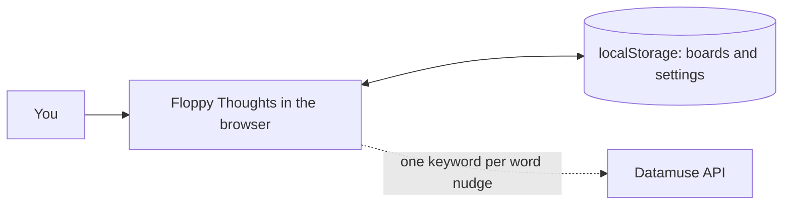
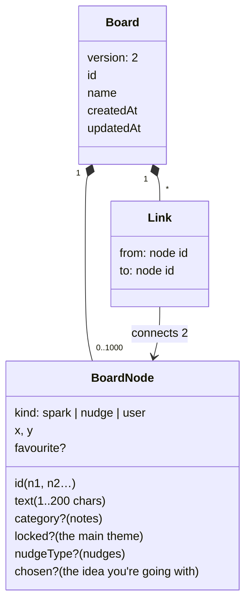
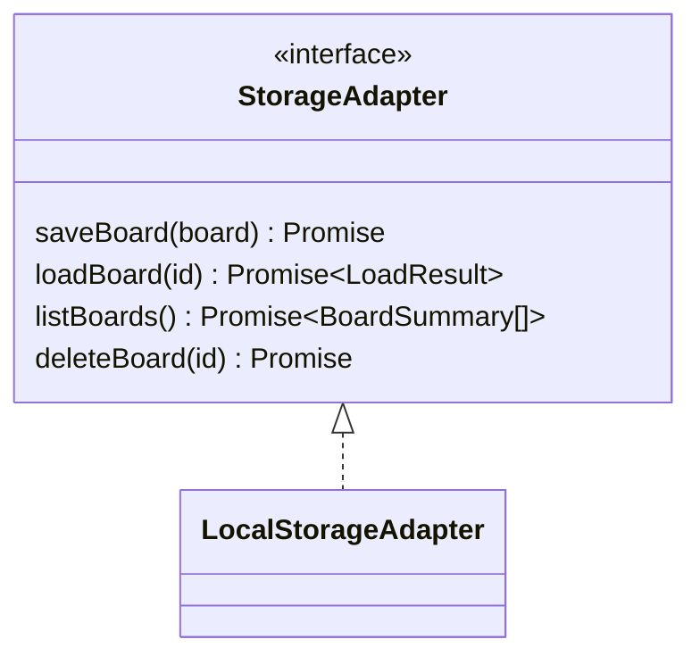
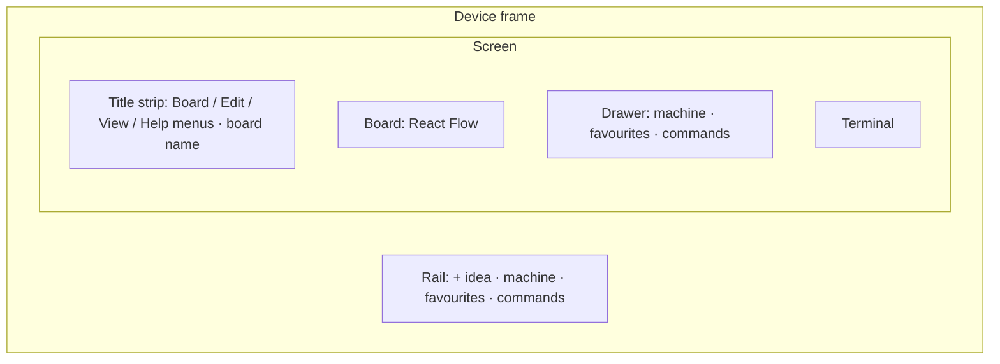
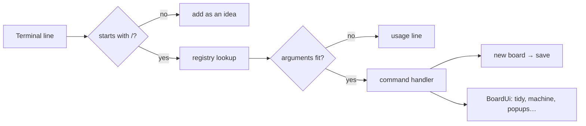
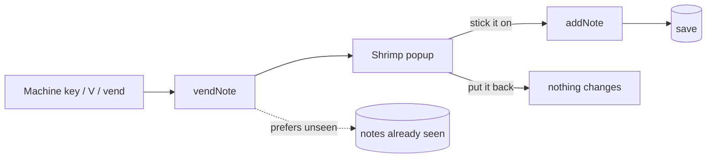
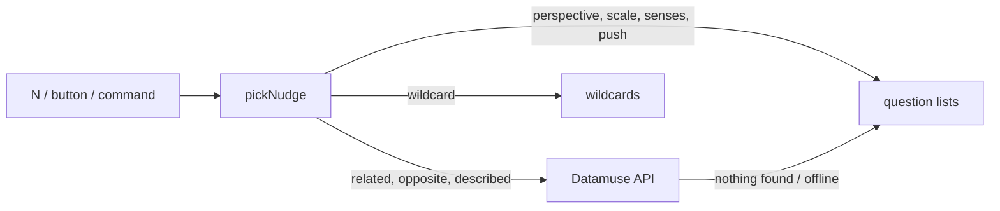

# Architecture

How Floppy Thoughts works today. For what it's for and why, see the [vision](../vision.md) and [PRD](prd.md).

> **Naming:** in the app, starting thoughts are **notes** (shrimp notes from the vending machine). In the code and saved data they're `spark` (`kind: 'spark'`, `src/lib/sparks/`), which keeps saved boards compatible.

## Overview

A single-page React app with no backend. Everything runs in the browser and boards are saved in `localStorage`, so it costs nothing to host (GitHub Pages) and works offline. The only network call is an optional word lookup for nudges.

| Part | Where | What it does |
|---|---|---|
| Board model | `src/lib/board.ts` | Zod schema: the types and the checks for saved boards |
| Board operations | `src/lib/boardOps.ts` | Pure functions that return a new board (add, edit, link, delete, favourite…) |
| Commands | `src/lib/commands.ts` | The command registry and router for the terminal |
| Completion | `src/lib/complete.ts` | Tab completion, by command, number or words |
| Layout | `src/lib/placement.ts`, `src/lib/tidy.ts` | Where new boxes go; the tidy layout |
| Storage | `src/lib/storage.ts`, `src/lib/keys.ts` | The storage interface, its localStorage version, key names |
| Notes and nudges | `src/lib/sparks/`, `src/lib/nudges/` | The vending machine's content; nudge picking |
| Screens | `src/components/` | React components (board, terminal, drawer, popups, menus, home) |
| Styles | `src/styles/` | One CSS file per part of the screen |

## Board data model

Boards are versioned JSON, checked with Zod whenever they're loaded or saved.

**Checked on every load:**
- Node ids are unique; links point to real nodes, with no self-links and no duplicates in either direction.
- `category` and `locked` belong only to notes, `nudgeType` only to nudges.
- At most one idea is `chosen`.
- At most 1,000 nodes. There's no limit on brainstorming; this only stops a runaway board filling browser storage.
- Older board versions are upgraded on load.

## Storage

The app only talks to the `StorageAdapter` interface, so a server-backed version can replace `LocalStorageAdapter` without changing anything else.

- Keys live in `src/lib/keys.ts`, all under `floppy:` (boards, the last open board, panel and terminal sizes, notes already seen).
- **Saving** validates first, so an invalid board is never written. A full browser storage raises `StorageFullError` with a friendly message.
- **Loading** returns `ok`, `not-found` or `invalid`. It never crashes on corrupted or tampered data, and broken entries are skipped but kept.
- **Each edit is one write.** The board list is updated from the board that changed (`withSummary`) rather than re-reading every board.
- **Async on purpose:** localStorage is synchronous, but a server won't be.

## The screen

- **Board:** React Flow handles pan, zoom, touch and dragging. Its attribution link stays visible. Boxes are styled as files in an IDE (`~/idea`, `~/word`…), nudges as `// comments`.
- **Title strip:** VS Code-style menus. Board (new, recent boards, all boards, rename, favourites on a new board, my idea, delete), Edit (undo, redo, add, theme, nudge, delete, tidy), View (drawer tabs, terminal, fit to screen), Help.
- **Drawer:** resizable and closable. Its width is remembered.
- **Terminal:** resizable; its height is remembered.

## Adding and editing

- **Type a thought** in the terminal and press Enter: it becomes an idea. Anything without a leading `/` is a thought.
- **Double-click** empty board, or the **+** button, adds an idea ready to type.
- **Tab** on a selected box adds an idea linked to it; **Tab while typing** saves and starts the next, so a chain needs no mouse.
- What you just added is **selected**, so Tab, N, F and Delete act on it. **Esc** in the terminal moves the keyboard to the board; **/** or **Ctrl+`** moves it back.
- New boxes go in a **free spot on screen**; if the view is full, the board glides to show where it landed.
- Only what you wrote can be edited (your ideas and the main theme). Anything can be deleted or favourited.
- **Undo/redo** keep whole-board snapshots in memory (up to 100). Ctrl/Cmd+Z, Ctrl/Cmd+Shift+Z, or `/undo` and `/redo`.

## Links

Links are undirected and any two things can be linked.

- **Drag** from a box's dot onto another box. The line you drag is the same straight, edge-to-edge line a finished link is, and it snaps to the box under the cursor.
- **Commands:** `/link 4 2 5` links 4 to 2 and to 5; `/unlink` works the same way, and `/unlink 4` clears all of 4's links.
- **Deleting from a chain** (A–B–C, deleting B) asks whether to link A and C so the trail isn't broken. A box with three or more links just loses them. Undo restores either way.
- Links are never scored or rewarded: judging connections would steer people towards "what wins" rather than "what's interesting".

## Commands

Every command is one entry in a **registry** in `src/lib/commands.ts`: name, aliases, group, usage, description, argument kinds and what it does. The help, the commands tab, usage errors, argument checks, Tab completion and routing are all generated from it.

- **Commands start with `/`**, like Slack or Discord, so a thought is never mistaken for one. A mistyped command gets its usage line back instead of becoming an idea.
- **Ids are numbers** (1, 2, 3…), saved as `n1`, `n2`…. They only appear on boxes while you're typing a command, so the board stays calm.
- **Tab completes** command names, numbers, and **thoughts by their words**: `/link 1 bag` + Tab fills in the number of "a bag that remembers".
- Commands that need the screen (tidy, the machine, popups) get a small `BoardUi` interface from the board, so the command logic stays unit-testable without a browser.
- `/help` opens the **commands tab** in the drawer; clicking a command there puts it in the terminal, ready to finish.

## Notes: the vending machine

- The machine sits in the drawer: a row per category (W words, O objects, P problems, C curiosities, N nature, ? surprise me). Any row can vend as often as you like, and you never get a note already on the board.
- A note arrives in a **popup**: the capsule drops and pops, and the pixel-art shrimp (`src/lib/shrimpPixels.ts`, original art drawn from a grid) cracks in half like a fortune cookie, with the note on the slip between the halves. Nothing lands until you choose to stick it on or put it back. Click or Enter skips the animation, and reduced-motion settings skip it entirely.
- **Content** is hand-picked and offline (`src/lib/sparks/content.ts`): concrete, true, kind, and never a finished idea.
- **Main theme:** one per board, asked for when the board is made, shown bigger and editable.

## Nudges

Select something and press **N**, use the box's **nudge** button, or type `/nudge 4 [type]`. One nudge is added beside it and linked to it. Nudges are words or questions, never ideas.

- **Nudges that fit:** the type depends on what's selected. Words and objects get word games, senses, perspective and scale; problems get perspective, scale and push; well-developed ideas get pushed rather than word games; word nudges only fire on short text; nudges can't be nudged.
- **No judging-criteria nudges** (impact, demo), for the same reason links aren't scored.
- **Datamuse privacy:** only one keyword is sent (preferring nouns), never the whole idea. Results are filtered, and the request times out after 3 seconds, falling back to a question.

## Tidy

The four-squares button under the zoom controls, Edit → Tidy, or `/tidy`. It only runs when asked, and one undo puts everything back.

1. Find each **group** of linked thoughts.
2. Lay each group out with `d3-force` from a clean, tree-like start, trying several arrangements and keeping the one with the **fewest crossing links**.
3. Place the groups side by side with space between them, biggest first; single unlinked boxes go last.
4. Keep the main theme where it is; boxes glide to their new places.

## Favourites, the one, and the summary

- **Favourite** anything (the heart, **F**, `/fav 4`). The favourites tab and `/favs` show this board's favourites; they're never counted or scored.
- **Favourites on a new board** copies them, with the links between them, onto a fresh board.
- **This is the one** (`/pick 4`) marks the idea you're going with. The summary shows the shortest trail from each note or theme to it, and can be copied.

## Boards and routes

Hash routes work on GitHub Pages with no server setup.

| Route | Page |
|---|---|
| `#/` | Home page |
| `#/new` | Makes a blank board, asks for a theme, opens it |
| `#/board` | The board you had open last |
| `#/boards` | All boards: open, rename, delete (with a confirm) |

Recent boards are also in the Board menu.

## Testing

| Kind | Command | Covers |
|---|---|---|
| Unit (Vitest) | `npm test` | The board model, operations, commands registry, completion, tidy, placement, storage, nudges, summary |
| Browser (Playwright) | `npm run test:e2e` | Real flows in Chromium: adding, selecting, deleting, chain prompt, links by drag and command, tidy and undo, fit, the machine popup, the commands tab, ids, keyboard shortcuts |

Browser tests start their own dev server on `127.0.0.1:5181`.

## Decisions

- **No LLM.** Nudges are words and questions from free sources, so the thinking stays yours and it costs nothing to run.
- **No scores, timers or limits.** They pull attention from exploring to performing.
- **Functional core.** Board changes are pure functions over immutable data, which makes undo simple and testing easy; OOP is used for the storage boundary, where implementations need to be swappable.
- **Data-driven commands.** One registry rather than scattered handlers, so a command's help, checks and completion can't drift apart.
- **Browser-only for now.** The storage interface is async and swappable for when accounts and shared boards arrive.

## Next

- Split `Workspace.tsx` into smaller pieces (command wiring, deleting, tidy).
- Accounts and shared boards (Supabase), with a privacy notice.
- A server-side proxy for Datamuse, which will need a key from February 2027.
- Pixel art for the machine and frame; phone layout.
